<p align="center">
  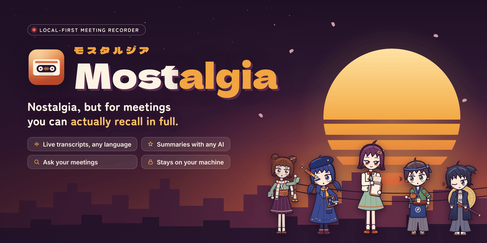
</p>

<p align="center">
  <b>Nostalgia, but for meetings you can actually recall in full.</b><br>
  A local-first meeting recorder for Linux: live transcription on your GPU, summaries that know who promised what,<br>
  and a search box that answers “wait, what did we decide?” — with a link to the exact second it was said.
</p>

<p align="center">
  
  
  
  
  
</p>

<p align="center">
  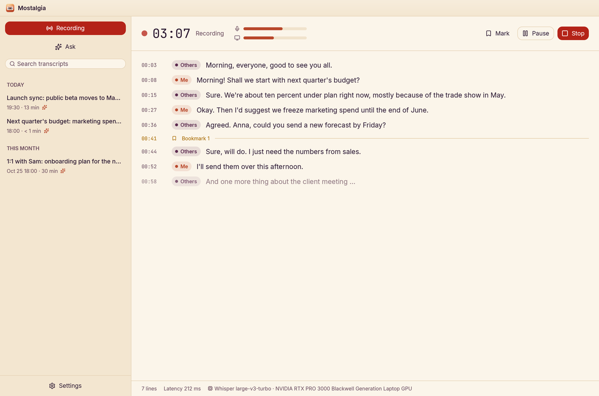
</p>

---

## Why Mostalgia?

You were *in* the meeting. You nodded. Three days later nobody remembers whether
the budget was frozen “until June” or “in June”. Mostalgia sits quietly next to
your call, writes everything down as it happens, and turns it into something you
can actually use: a summary with decisions and owners, a transcript you can click
to hear, and an assistant that answers questions across all your meetings.

The audio is transcribed **on your own GPU** and stays on your disk. Only the text
goes to the language model you pick — and you can pick a fully local one too.

## Features

<table>
<tr><td width="50%" valign="top">

### 🎙️ Recording
- Records **your mic and the other side of the call** (desktop audio) as separate tracks — so it always knows who said what: *Me* and *Others*.
- **Auto-start with calls**: notices when Zoom, Teams, Meet, Discord, Slack, Signal & co. grab the mic and offers (or just starts) to record — and stops when the call ends.
- Pause, bookmarks (“Mark”), live level meters, and a nudge when your mic has gone suspiciously quiet.
- Tray icon, a global shortcut (**Super + Shift + R**) and readable device names (“Laptop microphone”, not `alsa_input.pci-0000_80_1f.3…`).

</td><td width="50%" valign="top">

### ✍️ Live transcription
- **Whisper large-v3-turbo** via whisper.cpp on Vulkan — ~30× faster than real time on an RTX laptop GPU.
- **Provisional text after ~1 s** while someone is still talking, replaced by the clean line when they pause.
- **Silero VAD** decides what's speech, so silence never turns into “Vielen Dank.” hallucinations.
- After you stop, a **final pass** re-transcribes the full tracks for the archive.
- **Local, Hybrid or Cloud**: Whisper on your GPU, or cloud speech-to-text (OpenAI, Groq, a self-hosted Whisper server) for machines without one — chosen separately for live text and the final pass, with the cost per hour shown.
- **No silent fallbacks**: if a provider fails you see which one and why, the audio stays on disk, and *Transcribe again* lets you pick another engine.
- German, English or auto-detect; optional noise suppression (RNNoise).

</td></tr>
<tr><td valign="top">

### ✨ Summaries
- A title, short overview, key points, **decisions**, **action items with owners and deadlines**, and open questions — in the meeting's own language.
- **Bring your own model**: Claude, OpenAI, DeepSeek, or any OpenAI-compatible endpoint — **Ollama, LiteLLM, LM Studio, vLLM, OpenRouter, Groq, Together** or your own URL. Each connection shows whether it's connected, not set up, or failing (and why).
- Pick the model and **thinking level** where the model supports it; streams, so even “Maximum” thinking doesn't time out.

</td><td valign="top">

### 💬 Ask your meetings
- “What did Anna promise last week?” — answers **with clickable sources** that open the meeting at that line and play the audio.
- **Hybrid search**: BM25 keywords + multilingual e5 embeddings, fused with RRF, all local (~25 ms).
- Says so when nobody said it — no confident inventions.
- Works with local models too; a model without tool calling gets the search results up front.

</td></tr>
<tr><td valign="top">

### 🗣️ Speakers
- *Me* vs *Others* for free (separate tracks).
- Optional **speaker diarization** (sherpa-onnx, pyannote + WeSpeaker) splits the other side into Speaker 1, 2, …
- Rename a speaker once — every line follows.

</td><td valign="top">

### 🎨 Themes, languages & polish
- **20 themes** from warm *Mostalgia* to *Blockwelt* pixels, *Synthwave*, *Terminal* and a high-contrast mode; little animated scenes (respecting “reduce motion”).
- **UI in German and English**, switched live; proper **Arabic/RTL** rendering.
- Settings grouped into categories with search; right-click a meeting to rename, export (Markdown, text, SRT, Word) or delete it — completely, including its search index.

</td></tr>
</table>

## Gallery

| | |
|---|---|
| 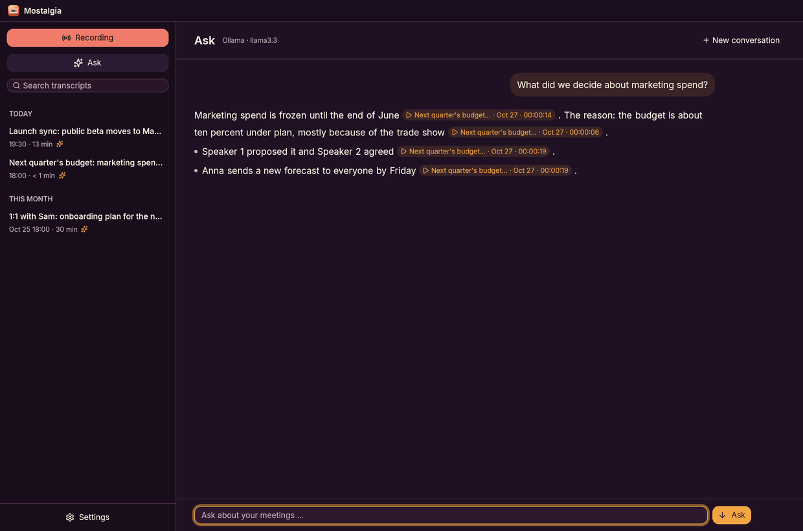 **Ask** — answers with source chips | 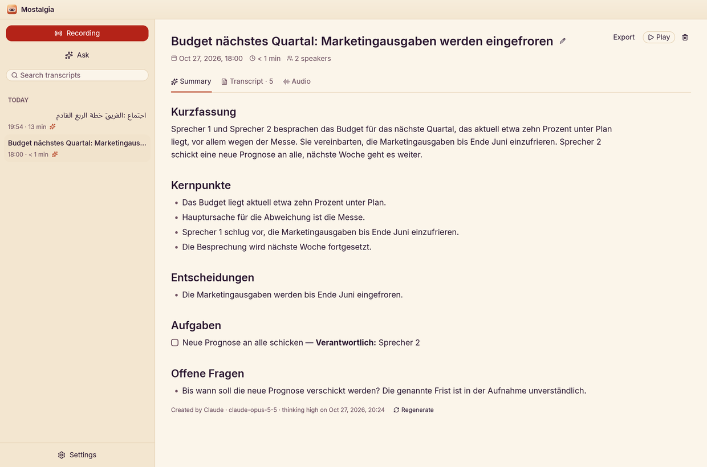 **Summary** — decisions and owners |
| 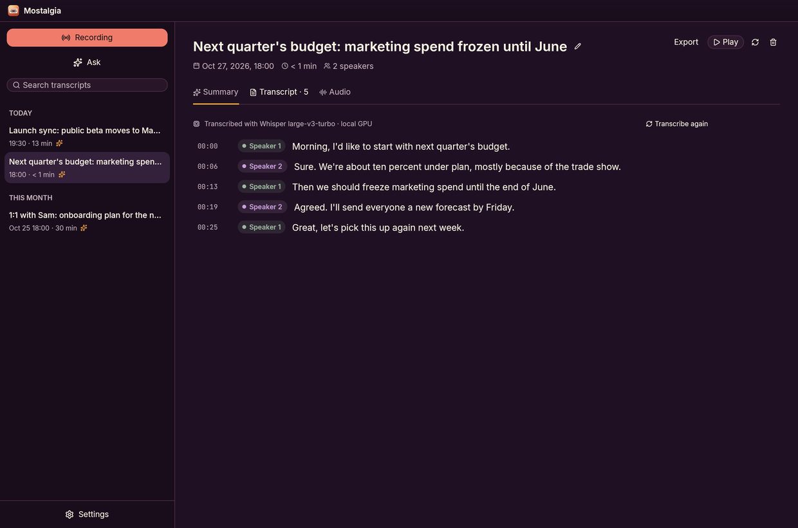 **Transcript** — click a time to play, click a chip to rename | 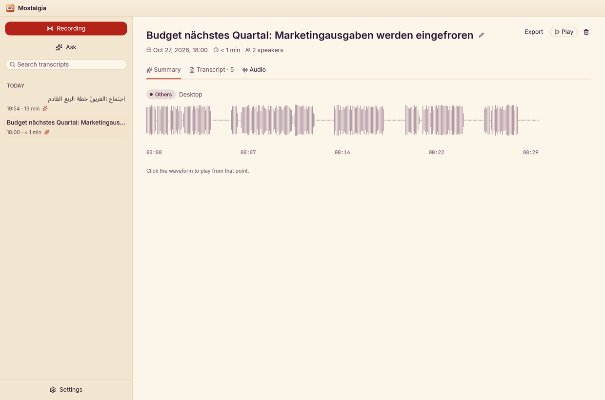 **Audio** — waveform per track, click to jump |
| 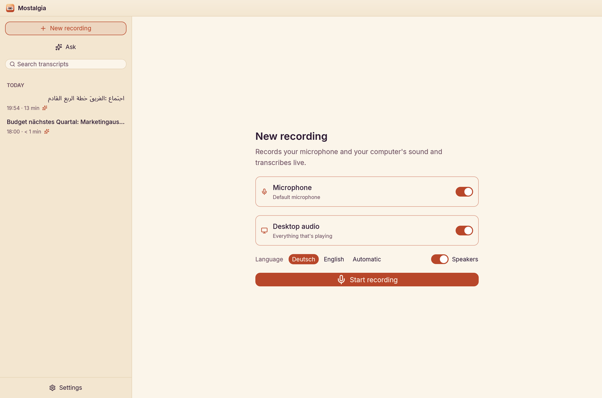 **New recording** | 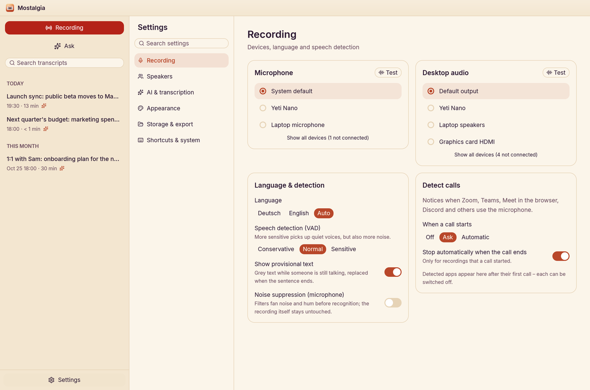 **Settings** — tidy categories |
| 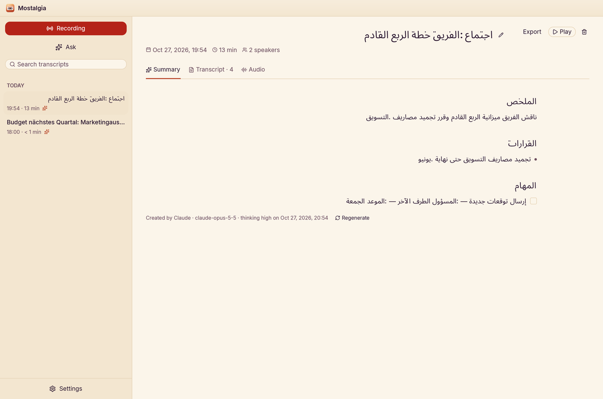 **Arabic / RTL** done right | 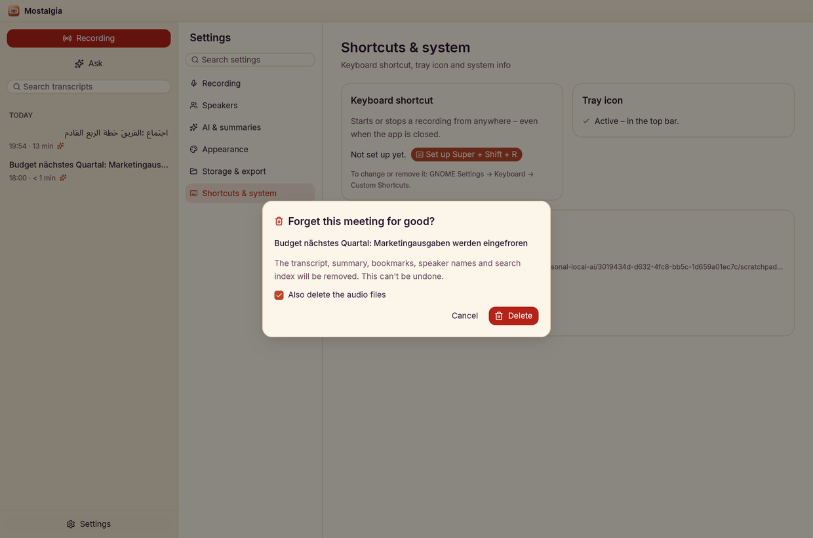 **Forget a meeting** — all of it |
| 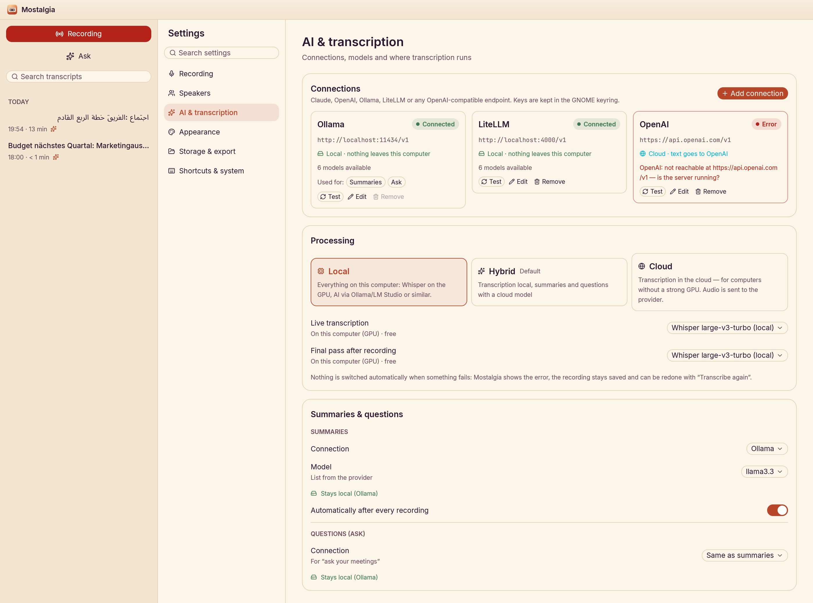 **Connections & modes** — local, hybrid or cloud, at a glance | 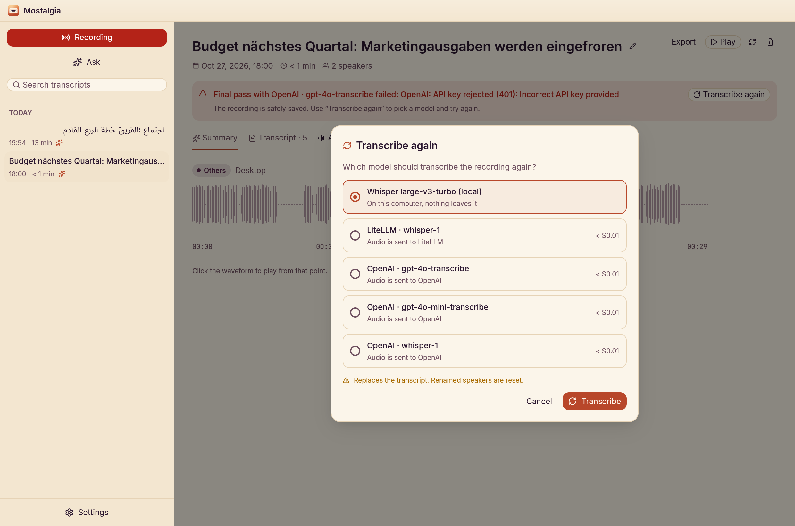 **Transcribe again** — you pick the engine, nothing switches by itself |
| 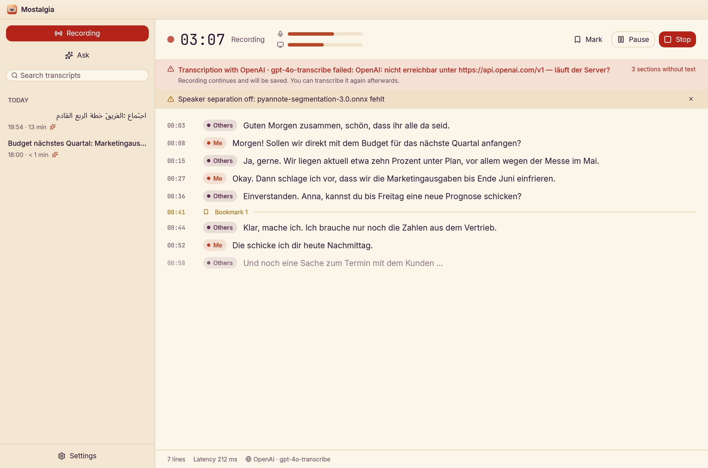 **Clear errors** — which provider failed and why; the recording keeps going | |

**Twenty themes**, each with its own palette, corners, fonts and speaker colours:

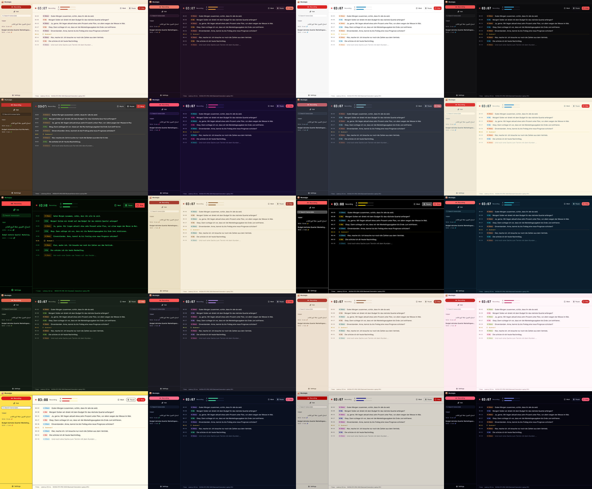

…and a small animated scene while you wait for the first word:

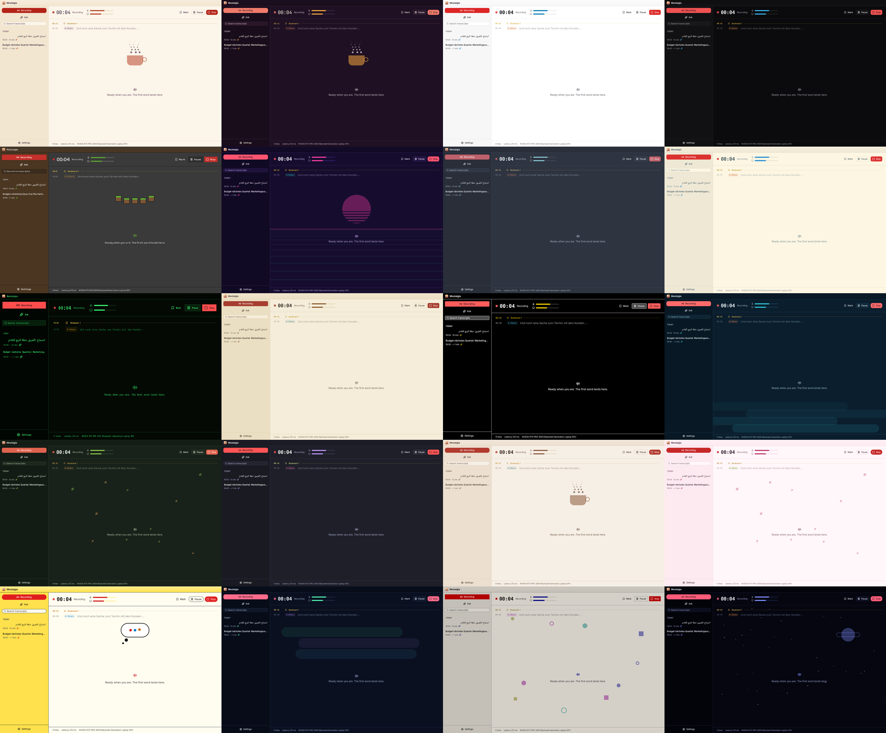

## Quick start

```bash
# 1. System packages (Ubuntu/Debian)
sudo apt install build-essential cmake clang pkg-config libpulse-dev pulseaudio-utils \
  libvulkan-dev glslc libxkbcommon-dev libxkbcommon-x11-dev libwayland-dev libx11-xcb-dev \
  libxcb1-dev libfontconfig-dev libfreetype-dev libasound2-dev libzstd-dev

# 2. Models: Whisper large-v3-turbo (~1.6 GB), Silero VAD, speaker + search models
./scripts/download-model.sh

# 3. Build (Vulkan works on NVIDIA/AMD/Intel without extra toolkits)
cargo build --release --features vulkan

# 4. Put it in your app grid, and add the Super+Shift+R shortcut
./scripts/install-desktop.sh
./scripts/install-gnome-shortcut.sh

# 5. For summaries and Ask: an API key (stored in the GNOME keyring) …
mostalgia set-api-key                       # Anthropic (Claude)
mostalgia set-api-key --provider openai     # or deepseek, groq, …
# … or keep it all local with Ollama
mostalgia connections add ollama
```

Then launch **Mostalgia** from the app grid, or `mostalgia-app`. The tray icon
needs GNOME's AppIndicator extension:
`gnome-extensions enable ubuntu-appindicators@ubuntu.com` (log out and in once).

## Privacy — what goes where

Mostalgia always shows where your data goes: every connection carries a
*local* or *cloud* badge, and the processing mode is spelled out in settings.

| Mode | Transcription | Summaries & *Ask* | Leaves your laptop |
|---|---|---|---|
| **Local** | Whisper on your GPU | a local model (Ollama, LM Studio, vLLM …) | nothing |
| **Hybrid** *(default)* | Whisper on your GPU | Claude, OpenAI, DeepSeek … | meeting **text** for summaries; only the **few passages** *Ask* looks up |
| **Cloud** | OpenAI, Groq or your Whisper server | any | **audio** to the transcription provider, text as above |

| | Where it lives |
|---|---|
| Recordings (WAV) | always on your disk, `~/.local/share/mostalgia` — whatever the mode |
| Search index for *Ask* (BM25 + embeddings) | always local |
| API keys | GNOME keyring, sent only to their own provider |

## How it works

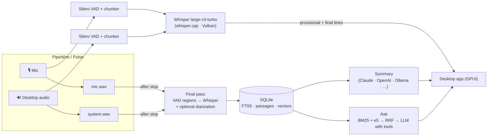

The workspace has three crates:

- **`mostalgia-core`** — capture, VAD, live chunking, Whisper, final pass,
  diarization, storage (SQLite + FTS5), summaries, *Ask*, call detection, i18n.
  Front ends drive a `Recorder` and listen to its event channel.
- **`mostalgia-app`** — the desktop app (GPUI + gpui-component).
- **`mostalgia-cli`** — the `mostalgia` command.

A few numbers from an RTX PRO 3000 laptop:

| | |
|---|---|
| Live transcription of a 9 s chunk | 0.2–0.4 s |
| First provisional text during continuous speech | ~1 s |
| Final pass | a second or two per minute of audio |
| Speaker diarization (optional) | ~5 min of CPU per hour of audio |
| *Ask* search over the whole library | 23–30 ms |
| *Ask* answer (Claude Opus 5.5, medium thinking) | ~5 s |

## CLI

```text
mostalgia start [--source mic|system|both] [--speakers] [--diarize] [--denoise] [--language de|en|auto]
                [--engine local|<connection>/<model>] [--final-engine …]
mostalgia list | show <id> | search <words> | ask "<question>"
mostalgia summarize <id> [--provider <connection>] [--summary-model …] [--effort low…max]
mostalgia export <id> --format md|txt|srt|docx [-o file]
mostalgia delete <id> [--keep-audio]
mostalgia import <session-folder> | transcribe <file.wav> | reindex [--all]
mostalgia retranscribe <id> --engine local|openai/gpt-4o-transcribe|groq/whisper-large-v3-turbo
mostalgia connections [list | add <preset> [--url …] | test <id> | remove <id>]
mostalgia toggle | open           # control the running app (shortcut-friendly)
mostalgia devices | models [--provider <connection>] | set-api-key [--provider <connection>]
```

The CLI speaks German or English, following the app's language setting.

## FAQ

**Does it work without a GPU?** Yes — build without `--features vulkan` and
Whisper runs on the CPU. It's slower; a smaller model (`--model`) helps.

**Which call apps are detected?** Zoom, Teams, Discord, Slack, Signal, Element,
Jitsi, Skype, Webex, Telegram, WhatsApp, and any call in Chrome, Chromium,
Firefox, Brave, Edge, Vivaldi or Opera (Meet, Teams on the web, …).

**My voice is missing from a call recording.** Check that the microphone is on in
*New recording* — recordings started for a detected call always include it, and a
banner warns you if the mic stays silent.

**Can I add my own theme?** Drop a JSON file into `~/.config/mostalgia/themes/`
— same fields as [`themes.json`](crates/mostalgia-app/assets/themes.json).

**Where is my data?** `~/.local/share/mostalgia` (database, recordings, models)
and `~/.config/mostalgia` (settings). Delete a meeting from the app and it's gone
from the library, the search index and — if you tick the box — the disk.

## Roadmap

- Meeting templates (stand-up, 1:1, customer call, interview)
- Action-item tracker across meetings, weekly digest
- Voice profiles that remember your colleagues

## Credits

- [whisper.cpp](https://github.com/ggml-org/whisper.cpp) / [whisper-rs](https://github.com/tazz4843/whisper-rs) and OpenAI's Whisper large-v3-turbo model (MIT)
- [Silero VAD](https://github.com/snakers4/silero-vad) (MIT)
- [sherpa-onnx](https://github.com/k2-fsa/sherpa-onnx) with pyannote segmentation 3.0 and WeSpeaker ResNet34 for diarization
- [multilingual-e5-small](https://huggingface.co/intfloat/multilingual-e5-small) (MIT) via [candle](https://github.com/huggingface/candle) for *Ask*
- [nnnoiseless](https://github.com/jneem/nnnoiseless) (RNNoise)
- [GPUI](https://github.com/zed-industries/zed) and gpui-component / gpui-kit for the UI; [Lucide](https://lucide.dev) icons
- Fonts (SIL OFL): Inter, JetBrains Mono, IBM Plex Sans, Atkinson Hyperlegible, Noto Sans Arabic, Pixelify Sans, VT323
- Summaries by [Claude](https://www.anthropic.com/claude), OpenAI, DeepSeek or a local model via Ollama, LiteLLM & co. — your choice

Brand, icon and palette: see [`assets/brand/BRANDING.md`](assets/brand/BRANDING.md).
