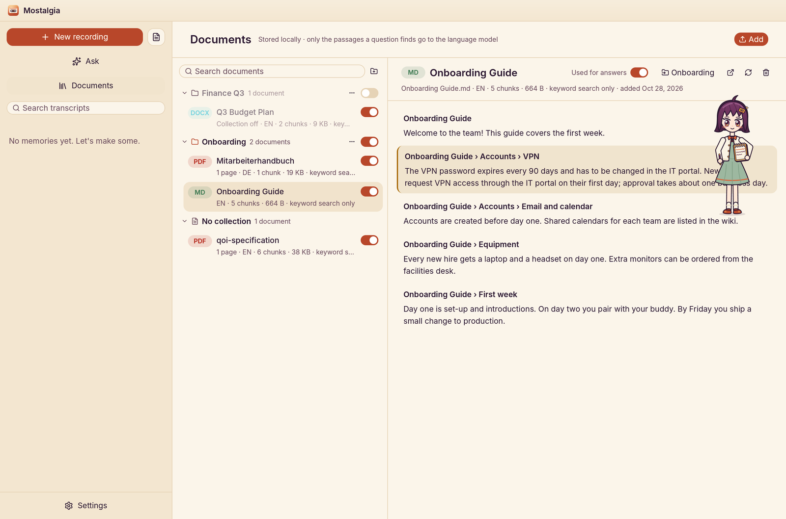
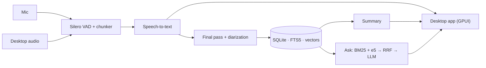

<p align="center">
  
</p>

<h2 align="center">Every meeting, remembered.</h2>

<p align="center">
  Mostalgia records your calls, transcribes them live on your own GPU,<br>
  and tells you what was decided, who owns what, and where it was said.
</p>

<p align="center">
  <a href="https://github.com/Mostaxd/Mostalgia/releases/latest/download/Mostalgia-x86_64.AppImage"></a>
  &nbsp;
  <a href="https://mostaxd.github.io/Mostalgia"></a>
</p>

<p align="center">
  <a href="https://github.com/Mostaxd/Mostalgia/releases/latest"></a>
  <a href="https://github.com/Mostaxd/Mostalgia/actions/workflows/ci.yml"></a>
  
  
</p>

<p align="center">
  
</p>

<table>
<tr>
<td width="33%" valign="top">

**Private by default**

Audio is transcribed on your machine and never leaves your disk. You decide whether summaries come from a local model or a cloud API.

</td>
<td width="33%" valign="top">

**Fast and live**

Whisper on Vulkan runs about 30× faster than real time. Text appears roughly one second after someone starts speaking.

</td>
<td width="33%" valign="top">

**Answers with sources**

Ask anything across all your meetings and documents. Every answer links to the moment it was said, with the audio one click away.

</td>
</tr>
</table>

---

## Capture every call, automatically


Mostalgia notices when Zoom, Teams, Meet, Discord, Slack, Signal and others
start using your microphone, and starts recording (or asks first). Your
microphone and the other side of the call are recorded on separate tracks, so
every line knows whether it came from you or from them.

- Optional speaker diarization separates every voice, and names you assign are remembered in later meetings
- Glossary corrections fix names and terms once, for good
- Live captions, live translation and a mic-silence warning
- Tray icon and <kbd>Super</kbd> + <kbd>Shift</kbd> + <kbd>R</kbd> from anywhere

<br clear="right">

## Summaries you can act on


When the meeting ends, a final pass re-transcribes both tracks and your chosen
AI writes the summary in the meeting's own language:

- Overview and key points
- **Decisions**, collected in a decision log across meetings
- **Action items** with owners and deadlines
- Open questions

Export to Markdown, text, SRT or Word, or keep it in Documents for later questions.

<br clear="left">

## Ask your meetings and your documents


*"What did Anna promise last week?"* Mostalgia searches every meeting and the
files you add (PDF, Word, Markdown, OpenDocument, HTML) with local hybrid
search in about 25 ms, then answers with numbered sources that open the
transcript at the exact line and play the audio.

When nothing in your sources answers the question, it says so instead of
guessing. During a call, it can even suggest answers from past meetings and documents.

<br clear="right">

<p align="center">
  
</p>

## A companion that takes notes with you


Turn on an animated note-taker who writes along while people talk, pins up
decisions, action items and numbers every ninety seconds, and answers
questions about the meeting that is still running. Keep them in the corner of
the app or floating above your call on the desktop.

| Mori | Tsumugi | Hoshi | Kaito | Jin |
|:---:|:---:|:---:|:---:|:---:|
| takes notes on a notepad | weaves them into her scarf | charts them as constellations | serves each note like tea | cuts each note onto paper |

<p align="center">
  
  
</p>

## Make it yours

Twenty themes, from warm *Mostalgia* to *Blockworld*, *Synthwave*, *Terminal*
and a high-contrast mode, each with its own palette, fonts and a small animated
scene. Or add your own as a JSON file in `~/.config/mostalgia/themes/`.

<p align="center">
  
</p>

---

## Get started

**1. Download and run**

```bash
chmod +x Mostalgia-x86_64.AppImage
./Mostalgia-x86_64.AppImage
```

**2. Download the speech models** when asked on first launch (~2.1 GB, once).

**3. Connect an AI** under *Settings → AI & transcription*: Ollama for a local
model, or a cloud provider with your own key.

Runs on x86_64 Linux with glibc 2.35+ (Ubuntu 22.04, Debian 12, Fedora 36 or
later), PipeWire or PulseAudio and a Vulkan driver. The AppImage updates itself.
Prefer to build it yourself? See [CONTRIBUTING.md](CONTRIBUTING.md#building).

## You choose where your data goes

| | Transcription | Summaries & Ask | Leaves your machine |
|---|---|---|---|
| **Local** | Whisper on your GPU | Ollama, LM Studio, vLLM, LiteLLM | nothing |
| **Hybrid** (default) | Whisper on your GPU | Anthropic, OpenAI, DeepSeek, OpenRouter, Groq, Together | meeting text; for Ask, only the passages it finds |
| **Cloud** | OpenAI, Groq or your own Whisper server | any | audio, plus text as above |

Every connection is labelled *local* or *cloud*. If a provider fails, you see
which one and why; Mostalgia never switches behind your back. Recordings and
the search index always stay in `~/.local/share/mostalgia`, and API keys in the
GNOME keyring.

<details>
<summary><b>For developers: architecture, performance and CLI</b></summary>

<br>

Mostalgia is written in Rust as three crates:
[`mostalgia-core`](crates/mostalgia-core) (capture, VAD, Whisper, diarization,
SQLite + FTS5 storage, summaries, Ask), [`mostalgia-app`](crates/mostalgia-app)
(desktop app on GPUI) and [`mostalgia-cli`](crates/mostalgia-cli).



| On an RTX PRO 3000 laptop | |
|---|---|
| Live transcription of a 9 s chunk | 0.2–0.4 s |
| First provisional text | ~1 s |
| Final pass | 1–2 s per minute of audio |
| *Ask* search over the whole library | 23–30 ms |

```text
mostalgia start [--source mic|system|both] [--diarize] [--language auto|<code>] [--translate <lang>]
mostalgia list | show <id> | search <words> | ask "<question>"
mostalgia docs [list | add <files> | search <words> | remove <id>]
mostalgia summarize <id> | export <id> --format md|txt|srt|docx
mostalgia connections [list | add <preset> | test <id> | remove <id>]
mostalgia toggle | open
```

</details>

## Community

Questions and ideas: [Discussions](https://github.com/Mostaxd/Mostalgia/discussions) ·
Contributing: [CONTRIBUTING.md](CONTRIBUTING.md) ·
[Code of Conduct](CODE_OF_CONDUCT.md) · Security: [SECURITY.md](SECURITY.md)

## License

Dual-licensed under [Apache-2.0](LICENSE-APACHE) or [MIT](LICENSE-MIT).
Copyright 2026 Mostafa Ahmed ([github.com/Mostaxd](https://github.com/Mostaxd)).
Forks are welcome; keep the [NOTICE](NOTICE) file and credit
*"Based on Mostalgia by github.com/Mostaxd"*.

Built with [whisper.cpp](https://github.com/ggml-org/whisper.cpp),
[Silero VAD](https://github.com/snakers4/silero-vad),
[sherpa-onnx](https://github.com/k2-fsa/sherpa-onnx),
[candle](https://github.com/huggingface/candle) with multilingual-e5,
[nnnoiseless](https://github.com/jneem/nnnoiseless) and
[GPUI](https://github.com/zed-industries/zed).
