<p align="center">
  
</p>

<p align="center">
  <b>Nostalgia, but for meetings you can actually recall in full.</b><br>
  A local-first meeting recorder for Linux: live transcription in any language, summaries that know who promised what,<br>
  and a search box that answers “wait, what did we decide?” — with a link to the exact second it was said.
</p>

<p align="center">
  
  
  
  
</p>

<p align="center">
  
</p>

---

## Why Mostalgia?

You were *in* the meeting. You nodded. Three days later nobody remembers whether
the budget was frozen “until June” or “in June”. Mostalgia sits quietly next to
your call, writes everything down as it happens, and turns it into something you
can actually use: a summary with decisions and owners, a transcript you can click
to hear, and an assistant that answers questions across all your meetings.

By default the audio is transcribed **on your own GPU** and stays on your disk;
summaries and answers come from the AI provider *you* pick — a cloud API or a
model running on your own machine. You always see which one is doing the work.

## Features

<table>
<tr><td width="50%" valign="top">

### 🎙️ Recording
- Records **your mic and the other side of the call** (desktop audio) as separate tracks — so it always knows who said what: *Me* and *Others*.
- **Auto-start with calls**: notices when Zoom, Teams, Meet, Discord, Slack, Signal & co. grab the mic and offers (or just starts) to record — and stops when the call ends.
- Pause, bookmarks (“Mark”), live level meters, and a nudge when your mic has gone suspiciously quiet.
- Tray icon, a global shortcut (**Super + Shift + R**) and readable device names (“Laptop microphone”, not `alsa_input.pci-0000_80_1f.3…`).

</td><td width="50%" valign="top">

### ✍️ Live transcription
- **Whisper** via whisper.cpp on Vulkan — multilingual, and ~30× faster than real time on a laptop GPU.
- **Provisional text after ~1 s** while someone is still talking, replaced by the clean line when they pause.
- **Silero VAD** decides what's speech, so silence never turns into “Thanks for watching!” hallucinations.
- After you stop, a **final pass** re-transcribes the full tracks for the archive.
- **Local, Hybrid or Cloud**: Whisper on your GPU, or a cloud / self-hosted speech-to-text service for machines without one — chosen separately for live text and the final pass, with the cost per hour shown.
- **No silent fallbacks**: if a provider fails you see which one and why, the audio stays on disk, and *Transcribe again* lets you pick another engine.
- Auto-detects the language (or pin one); optional noise suppression (RNNoise).

</td></tr>
<tr><td valign="top">

### ✨ Summaries
- A title, short overview, key points, **decisions**, **action items with owners and deadlines**, and open questions — in the meeting's own language.
- **Bring your own AI**: any of the [supported providers](#supported-providers) or any OpenAI-compatible URL. Each connection shows whether it's connected, not set up, or failing — and why.
- Pick the model and, where it supports one, the **thinking level**; responses stream, so long thinking doesn't time out.

</td><td valign="top">

### 💬 Ask your meetings
- “What did Anna promise last week?” — answers **with clickable sources** that open the meeting at that line and play the audio.
- **Hybrid search**: BM25 keywords + multilingual e5 embeddings, fused with RRF, all local (~25 ms).
- Says so when nobody said it — no confident inventions. Or ask [Mori](#meet-mori) right in the middle of a meeting.
- Works with local models too; a model without tool calling gets the search results up front.

</td></tr>
<tr><td valign="top">

### 🗣️ Speakers
- *Me* vs *Others* for free (separate tracks).
- Optional **speaker diarization** (sherpa-onnx, pyannote + WeSpeaker) splits the other side into Speaker 1, 2, …
- Rename a speaker once — every line follows, and the voice is remembered: "Speaker 2" → "Felix" today is labelled *Felix* automatically in the next meeting. Manage or forget known voices in Settings → Speakers (only a voice print is kept, no audio).

</td><td valign="top">

### 🎨 Themes, languages & polish
- **20 themes** from warm *Mostalgia* to *Blockworld* pixels, *Synthwave*, *Terminal* and a high-contrast mode; little animated scenes (respecting “reduce motion”).
- English UI (German available, switched live); right-to-left text in transcripts renders properly.
- Settings grouped into categories with search; right-click a meeting to rename, export (Markdown, text, SRT, Word) or delete it — completely, including its search index.

</td></tr>
</table>

## Meet Mori 

Mori is Mostalgia's optional note-taker: a small animated companion who writes
along whenever someone speaks. She lives in the corner of the app window — or,
switched to **On the desktop**, floats above all your other windows (your call
app included) and can be dragged anywhere across your monitors.

- **Ask her live** — click her and ask about the meeting that's running right
  now (“What did we decide so far?”), or switch to *All meetings* to search
  your library. Answers stream in with small numbered sources that jump to the
  moment they come from. Every recording starts with a fresh chat; the
  conversation is kept with the meeting as *Chat with Mori*.
- **Live notes** — every 90 seconds or so of new conversation she pins up
  what she noticed: decisions, action items with owners, open questions and
  numbers. All of them are saved with the meeting in its *Notes* tab (pin the
  ones that matter most).
- **Honest about what she's doing** — the bubble shows whether she uses a
  local or a cloud model (hover for which one). Without one she tells you to set it up, and
  when a provider fails she says so (with a worried face), instead of
  pretending.
- Off by default: *Settings → Companion*, with placement (app window
  or desktop), size and how often she takes notes. On GNOME Wayland the desktop Mori
  runs as a small XWayland window — that's what lets her stay on top. She idles, listens, writes, thinks, talks, dozes off when you
  pause, and looks worried when something breaks:

<p align="center">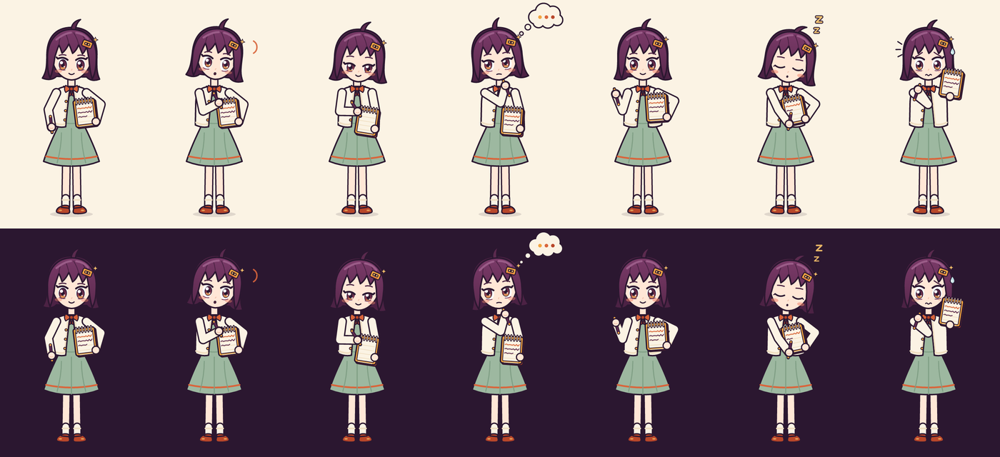</p>

| | |
|---|---|
| 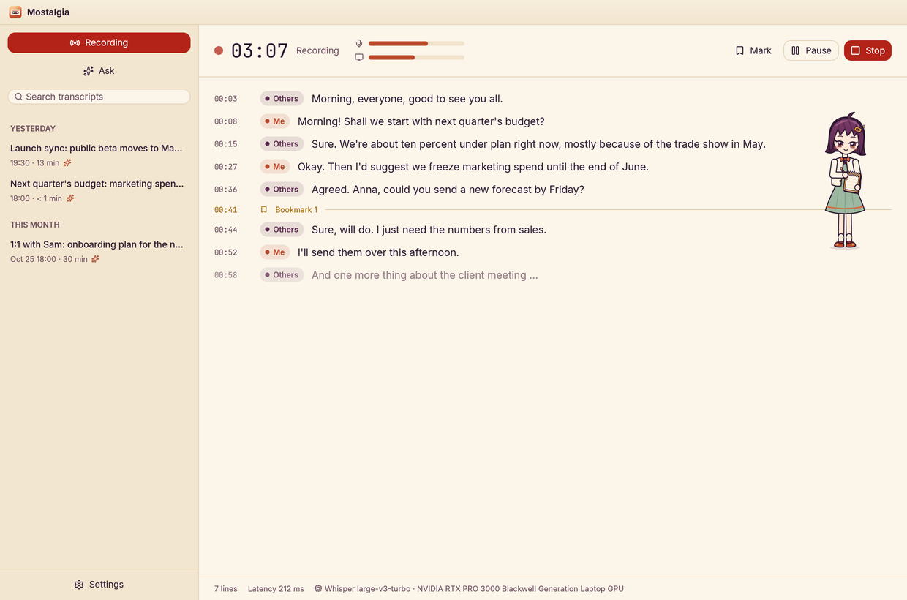 **Writing along** while people talk | 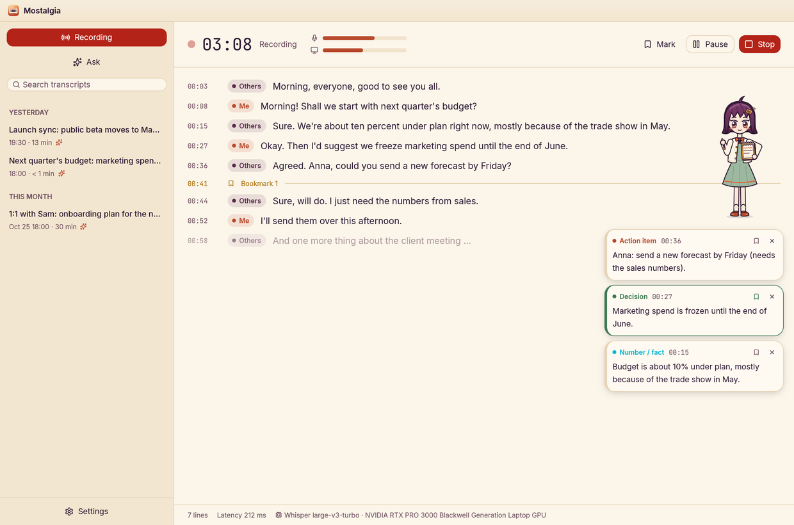 **Live notes** — pin what matters |
| 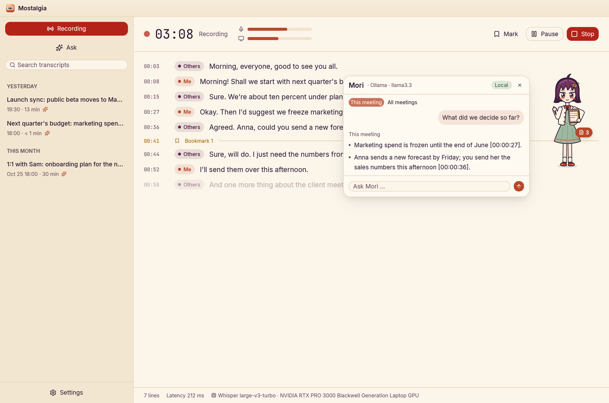 **Ask her** about this meeting or all of them | <p align="center">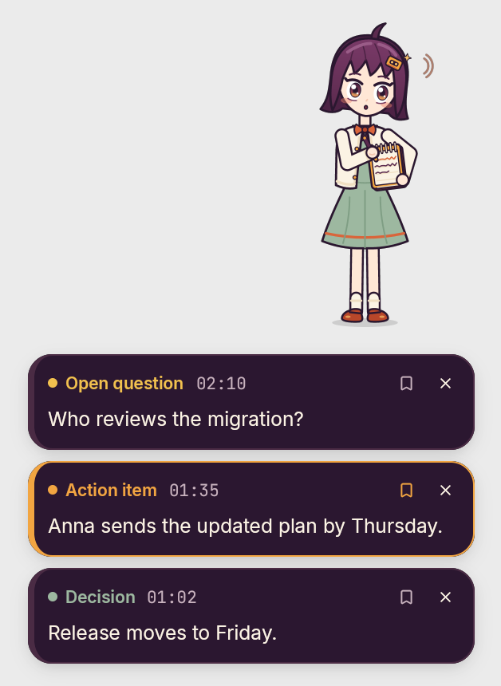 </p> **On the desktop** — transparent, always on top |

### Meet the companions

Mori isn't the only note-taker. In *Settings → Companion* you pick who keeps
you company — each with their own look, their own way of showing a new note
and their own (honest, concise) personality in the chat:

| | | |
|---|---|---|
| **Mori** takes notes on her notepad | **Tsumugi** weaves the notes into her scarf | **Hoshi** charts the notes as constellations |
|  | 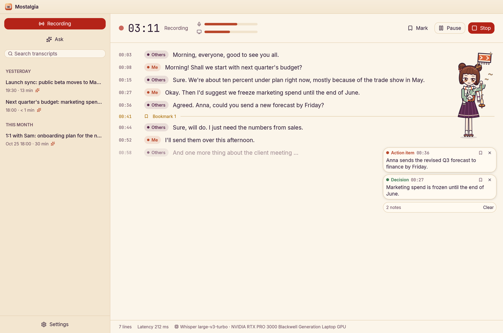 | 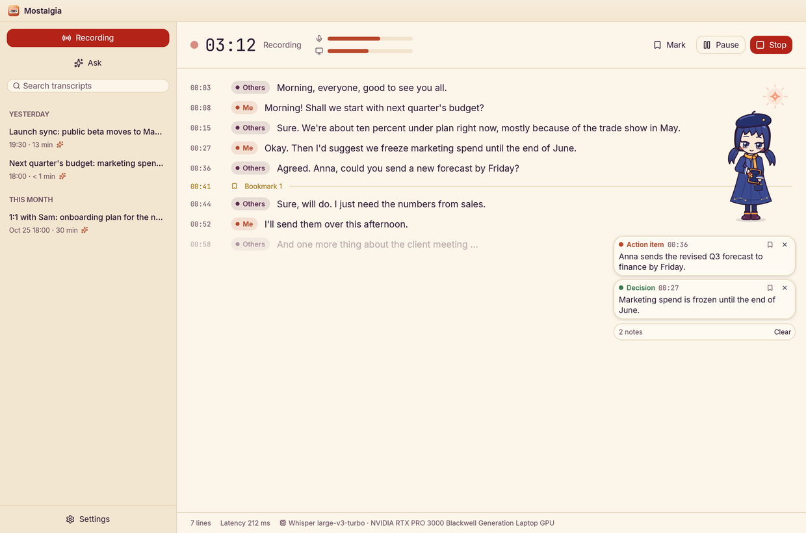 |
| **Kaito** serves each note like a cup of tea | **Jin** cuts each note onto a paper strip | |
| 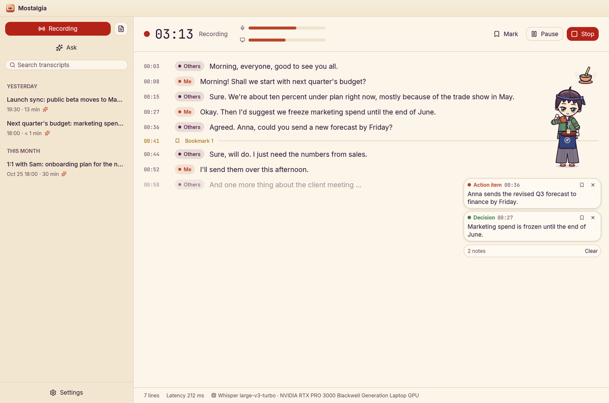 | 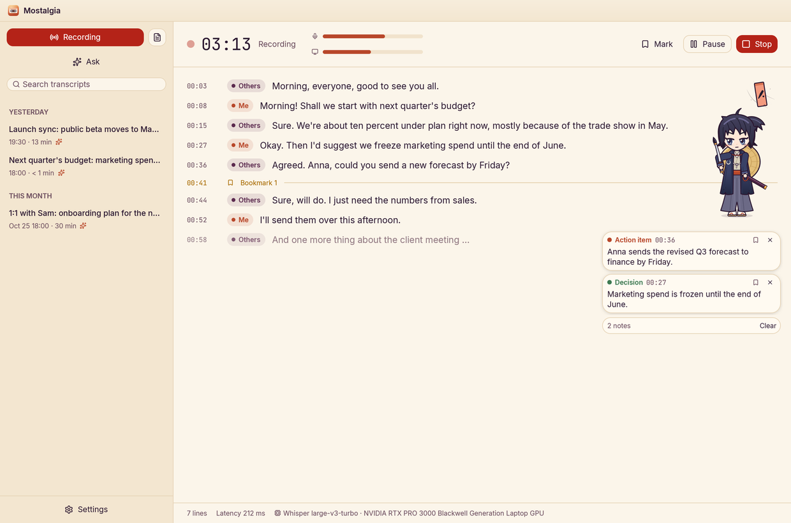 | |

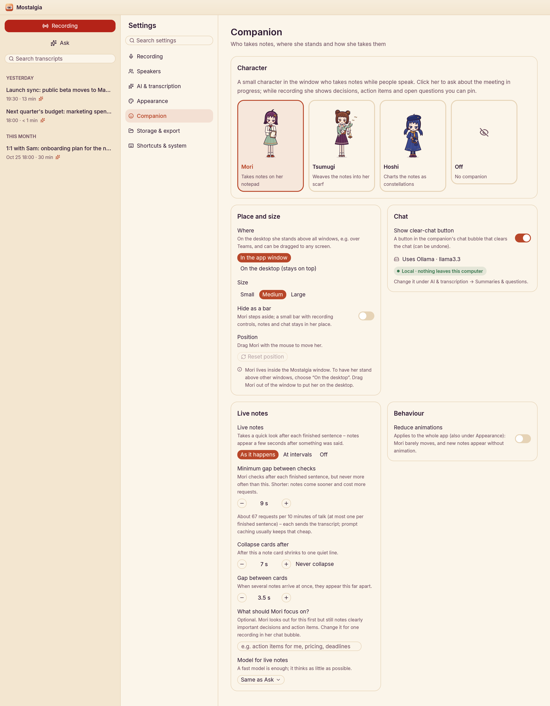

## Gallery

| | |
|---|---|
|  **Ask** — answers with source chips |  **Summary** — decisions and owners |
|  **Transcript** — click a time to play, click a chip to rename |  **Audio** — waveform per track, click to jump |
|  **New recording** |  **Settings** — tidy categories |
|  **Connections & modes** — local, hybrid or cloud, at a glance |  **Transcribe again** — you pick the engine, nothing switches by itself |
|  **Clear errors** — which provider failed and why; the recording keeps going |  **Forget a meeting** — all of it |

**Twenty themes**, each with its own palette, corners, fonts and speaker colours:


…and a small animated scene while you wait for the first word:


## Quick start

```bash
# 1. System packages (Ubuntu/Debian)
sudo apt install build-essential cmake clang pkg-config libpulse-dev pulseaudio-utils \
  libvulkan-dev glslc libxkbcommon-dev libxkbcommon-x11-dev libwayland-dev libx11-xcb-dev \
  libxcb1-dev libfontconfig-dev libfreetype-dev libasound2-dev libzstd-dev

# 2. Models: Whisper (~1.6 GB), Silero VAD, speaker + search models
./scripts/download-model.sh

# 3. Build (Vulkan works on NVIDIA/AMD/Intel without extra toolkits)
cargo build --release --features vulkan

# 4. Put it in your app grid, and add the Super+Shift+R shortcut
./scripts/install-desktop.sh
./scripts/install-gnome-shortcut.sh

# 5. Connect an AI provider for summaries and Ask — in the app under
#    Settings → AI & transcription, or from the terminal:
mostalgia connections add ollama            # a local model, no key needed
mostalgia set-api-key --provider openai     # or claude, deepseek, groq, … (GNOME keyring)
```

Then launch **Mostalgia** from the app grid, or `mostalgia-app`. The tray icon
needs GNOME's AppIndicator extension:
`gnome-extensions enable ubuntu-appindicators@ubuntu.com` (log out and in once).

## Supported providers

Add as many connections as you like and choose, separately, which one writes
summaries, which one answers *Ask*, and which engine transcribes live and in
the final pass.

**Summaries & Ask**

| Provider | Runs | What it receives |
|---|---|---|
| Ollama, LM Studio, vLLM, LiteLLM | on your machine or network | meeting text — it never leaves your hardware |
| Any OpenAI-compatible URL | wherever you host it | meeting text |
| Anthropic (Claude), OpenAI, DeepSeek | cloud | meeting text for summaries; for *Ask*, only the passages it looks up |
| OpenRouter, Groq, Together | cloud | the same, routed to the model you pick |

Models are listed live from each provider (`/models`), and you can always type
a model id by hand. Models without tool calling still work with *Ask*: the app
searches first and hands them the results — and says so.

**Transcription**

| Engine | Runs | What it receives |
|---|---|---|
| Whisper via whisper.cpp (Vulkan, CUDA or CPU) | on your machine | nothing leaves it |
| Self-hosted Whisper server (OpenAI-compatible `/audio/transcriptions`, e.g. via LiteLLM or vLLM) | your network | audio |
| OpenAI, Groq | cloud | audio, billed per minute (the app shows the estimate) |

## Privacy — what goes where

Mostalgia always shows where your data goes: every connection carries a
*local* or *cloud* badge, and the processing mode is spelled out in settings.

| Mode | Transcription | Summaries & *Ask* | Leaves your laptop |
|---|---|---|---|
| **Local** | Whisper on your GPU | a local model | nothing |
| **Hybrid** *(default)* | Whisper on your GPU | a cloud provider | meeting **text** for summaries; only the **few passages** *Ask* looks up |
| **Cloud** | a cloud speech-to-text service | any | **audio** to the transcription provider, text as above |

Nothing ever switches provider behind your back: if one fails you get an error
naming it, the recording stays on disk, and *Transcribe again* lets you choose
another engine.

| | Where it lives |
|---|---|
| Recordings (WAV) | always on your disk, `~/.local/share/mostalgia` — whatever the mode |
| Search index for *Ask* (BM25 + embeddings) | always local |
| API keys | GNOME keyring, sent only to their own provider |

## How it works

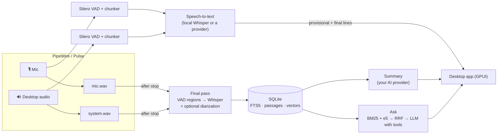

The workspace has three crates:

- **`mostalgia-core`** — capture, VAD, live chunking, Whisper, final pass,
  diarization, storage (SQLite + FTS5), summaries, *Ask*, call detection, i18n.
  Front ends drive a `Recorder` and listen to its event channel.
- **`mostalgia-app`** — the desktop app (GPUI + gpui-component).
- **`mostalgia-cli`** — the `mostalgia` command.

A few numbers from an RTX PRO 3000 laptop:

| | |
|---|---|
| Live transcription of a 9 s chunk | 0.2–0.4 s |
| First provisional text during continuous speech | ~1 s |
| Final pass | a second or two per minute of audio |
| Speaker diarization (optional) | ~5 min of CPU per hour of audio |
| *Ask* search over the whole library | 23–30 ms |
| *Ask* answer with a cloud model | ~5 s |

## CLI

```text
mostalgia start [--source mic|system|both] [--speakers] [--diarize] [--denoise] [--language auto|<code>]
                [--engine local|<connection>/<model>] [--final-engine …]
mostalgia list | show <id> | search <words> | ask "<question>"
mostalgia summarize <id> [--provider <connection>] [--summary-model …] [--effort low…max]
mostalgia export <id> --format md|txt|srt|docx [-o file]
mostalgia delete <id> [--keep-audio]
mostalgia import <session-folder> | transcribe <file.wav> | reindex [--all]
mostalgia retranscribe <id> --engine local|<connection>/<model>
mostalgia connections [list | add <preset> [--url …] | test <id> | remove <id>]
mostalgia toggle | open           # control the running app (shortcut-friendly)
mostalgia devices | models [--provider <connection>] | set-api-key [--provider <connection>]
```

The CLI follows the app's language setting (English by default).

## FAQ

**Does it work without a GPU?** Yes — build without `--features vulkan` and
Whisper runs on the CPU. It's slower; a smaller model (`--model`) helps — or
switch transcription to a provider in *Cloud* mode.

**Which call apps are detected?** Zoom, Teams, Discord, Slack, Signal, Element,
Jitsi, Skype, Webex, Telegram, WhatsApp, and any call in Chrome, Chromium,
Firefox, Brave, Edge, Vivaldi or Opera (Meet, Teams on the web, …).

**My voice is missing from a call recording.** Check that the microphone is on in
*New recording* — recordings started for a detected call always include it, and a
banner warns you if the mic stays silent.

**Can I add my own theme?** Drop a JSON file into `~/.config/mostalgia/themes/`
— same fields as [`themes.json`](crates/mostalgia-app/assets/themes.json).

**Where is my data?** `~/.local/share/mostalgia` (database, recordings, models)
and `~/.config/mostalgia` (settings). Delete a meeting from the app and it's gone
from the library, the search index and — if you tick the box — the disk.

## Roadmap

- Meeting templates (stand-up, 1:1, customer call, interview)
- Action-item tracker across meetings, weekly digest
- Voice profiles that remember your colleagues

## Credits

- [whisper.cpp](https://github.com/ggml-org/whisper.cpp) / [whisper-rs](https://github.com/tazz4843/whisper-rs) and OpenAI's Whisper models (MIT)
- [Silero VAD](https://github.com/snakers4/silero-vad) (MIT)
- [sherpa-onnx](https://github.com/k2-fsa/sherpa-onnx) with pyannote segmentation 3.0 and WeSpeaker ResNet34 for diarization
- [multilingual-e5-small](https://huggingface.co/intfloat/multilingual-e5-small) (MIT) via [candle](https://github.com/huggingface/candle) for *Ask*
- [nnnoiseless](https://github.com/jneem/nnnoiseless) (RNNoise)
- [GPUI](https://github.com/zed-industries/zed) and gpui-component / gpui-kit for the UI; [Lucide](https://lucide.dev) icons
- Fonts (SIL OFL): Inter, JetBrains Mono, IBM Plex Sans, Atkinson Hyperlegible, Noto Sans Arabic, Pixelify Sans, VT323

Brand, icon and palette: see [`assets/brand/BRANDING.md`](assets/brand/BRANDING.md).

## Contributing

Bug reports, ideas and pull requests are welcome. See
[CONTRIBUTING.md](CONTRIBUTING.md) for how to build, test and open a pull
request, and the [Code of Conduct](CODE_OF_CONDUCT.md) for how we treat each other.
To report a security problem privately, see [SECURITY.md](SECURITY.md).

## License

Mostalgia is licensed under either of

- [Apache License, Version 2.0](LICENSE-APACHE)
- [MIT license](LICENSE-MIT)

at your option. Copyright 2026 Mostafa Ahmed ([github.com/Mostaxd](https://github.com/Mostaxd)).

**Forks are welcome.** If you share or ship a copy or a changed version, keep
the [NOTICE](NOTICE) file and credit the original project, for example in your
README or About screen: *"Based on Mostalgia by github.com/Mostaxd"*. Please
don't present a fork as the official Mostalgia.

Third-party code, models and fonts listed under [Credits](#credits) keep their
own licenses.
